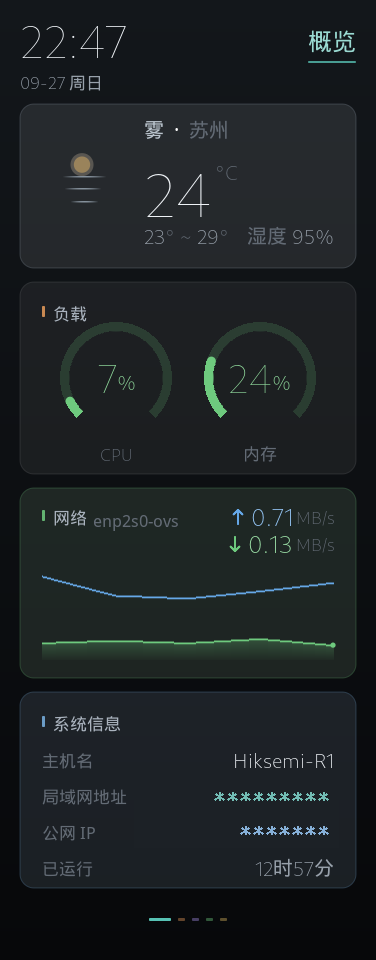
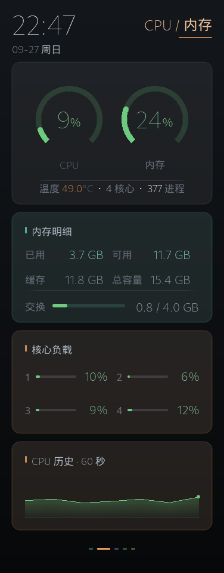
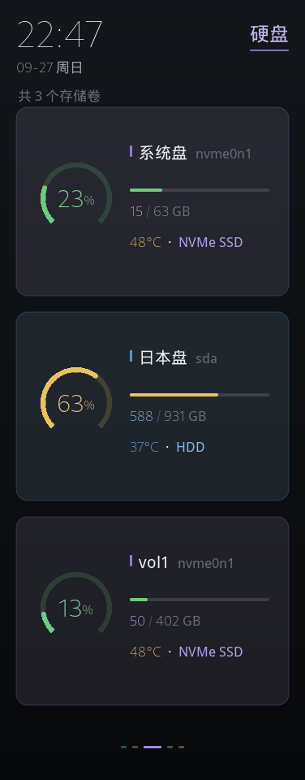
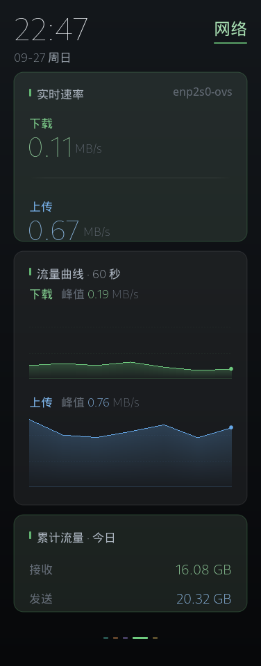
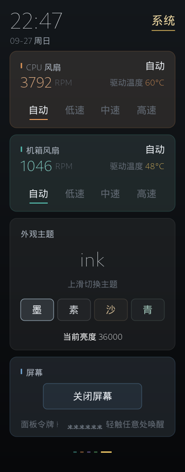

# R1 FrontScreen

海康威视 R1 / R1X NAS 前置触摸屏的硬件管理工具：Material You 三页信息面板（环境/详情/系统）、Web 控制面板、智能风扇调速、天气展示。

> 本项目基于 [lemon6515/r1-toolbox-go](https://github.com/lemon6515/r1-toolbox-go) 增强 fork 而来，遵循上游 **GPL-3.0 + Commons Clause** 许可证，感谢上游作者的开源工作。

## 界面预览

### v0.8.0 · Material You 三页版（当前）

| 环境（主屏） | 详情 | 系统 |
|:---:|:---:|:---:|
|  |  |  |

*三页触摸翻页 · 100px 大时钟+天气融合 · 首屏放趋势（CPU 60 秒曲线）、每核明细在详情页 · 每卡一色的低饱和 tonal 配色 · 读数与进度条共用一套阈值色（<50 绿 / ≥50 沙金 / ≥80 珊瑚）· 截图中局域网与公网地址已替换为 RFC 5737 文档保留地址（`192.168.1.10` / `203.0.113.42`），面板令牌按设计本就只显示「已设置 / 未设置」，明文从不上屏*

**对比旧版五页（v0.3.0 及以前）的变化**：

| | 旧版五页 | 新版三页 |
|---|---|---|
| 页面结构 | 概览/性能/硬盘/网络/系统 | 环境/详情/系统 |
| 首屏主角 | 46px 顶栏小时钟 + 指标卡 | 100px 大时钟 + 天气融合（环境屏风格） |
| 负载表达 | 双环仪表 + 每核百分比 | 大数字 + 细进度条 + 每核条 |
| 配色 | 单强调色 + 语义色描边 | 每卡一个低饱和色相（tonal 卡面） |
| 上下行速率 | 数字行 | 独立大卡（大数字 + 双曲线 + 今日累计） |
| 公网 IP | 完整明文 | 完整明文（屏上不遮蔽，排障要读全；仅外发截图时替换为文档保留地址） |

<details>
<summary><b>旧版五页界面截图（点击展开）</b></summary>

| 概览 | CPU / 内存 | 硬盘 | 网络 | 系统 |
|:---:|:---:|:---:|:---:|:---:|
|  |  |  |  |  |

</details>

## 本 fork 的主要改进

| 方向 | 内容 |
|---|---|
| **性能** | CPU 占用从约 89% 优化到 **单核约 2%**（60 秒窗口实测在 1.6%~2.3% 之间波动，长期基线 2.1%；跳帧渲染 + 局部重绘 + 圆角遮罩缓存 + 亚像素插值 + 采样减频） |
| **安全** | Web 面板令牌鉴权（首次启动自动生成；屏幕系统页只报「已设置 / 未设置」，**明文从不上屏** —— 墙上的屏谁路过都能看见，令牌印上去等于把钥匙贴门上）、亮度/风扇曲线等接口输入校验、修复磁盘监控数据竞争（`-race` 验证） |
| **体验** | 负载阈值色（读数与进度条同一套：**<50% 常态 · ≥50% 沙金 · ≥80% 珊瑚**；进度条常态为薄荷绿，不再有「黄字配绿条」）、天气图标静态化（相位冻结）、屏幕夜间自动调暗（18:00–06:00 背光降至 `night_brightness`）、配置文件保存保留注释、崩溃自愈（systemd 加固） |
| **可读性** | 指标数字常态色降到 `#D4D4D4`（纯白在 376×960 小屏上会「发光」，降一档后不再抢标题与点缀色的注意力）；时钟、卡片标题、主机名仍为纯白，保留信息层次顶端 |
| **可靠性** | systemd 看门狗（`Type=notify` + `WatchdogSec=30`，主循环卡死 30 秒内自动重启，不再「进程活着但画面定格」）、smartctl/lsblk 硬超时（D 状态进程不会卡住渲染）、采样移到后台协程 + 不可变快照（`-race` 实测归零）、GitHub Actions 五道门（fmt/vet/test/test -race/build） |
| **代码** | 渲染器模块化拆分（canvas / design / textrender / theme / widgets；设计常量与阈值取色集中在 `design.go`，改配色只动一处）、删除无人消费的死代码 |

## 硬件与系统要求

- 海康威视 **R1** 或 **R1X** NAS（程序经 SDL2 输出到前置屏幕，走 KMS/DRM 的 `/dev/dri/card*`；另需背光 sysfs 与风扇 hwmon。**无法在普通电脑上运行**）
- 飞牛 fnOS 或 Debian/Ubuntu 系发行版
- 编译需要 Go 1.19+；Docker 构建方式无需在本机装 Go

## 部署方式

> **不想在本机装 Go？** [Releases](https://github.com/mingyangbest/r1-frontscreen/releases) 提供预编译二进制。
> R1 / R1X 是 Intel N100（**x86_64**），请取 `r1-toolbox-linux-amd64`；
> `r1-toolbox-linux-arm64` 仅供其他 ARM 主板使用，装到 R1 上会直接「无法执行」。

### 方式 A：一键脚本（推荐，宿主机 systemd 服务）

```bash
git clone https://github.com/mingyangbest/r1-frontscreen.git
cd r1-frontscreen
sudo ./install.sh
```

脚本自动完成：系统依赖安装（SDL2、smartmontools 等）、编译、配置文件生成、systemd 服务注册（`Type=notify` + `WatchdogSec=30` 看门狗：主循环卡死 30 秒内自动重启，不再出现「进程活着但画面定格」）。

> 旧版升级：如果设备上已有 `Type=simple` 的旧单元，补一个 drop-in 即可启用看门狗：
>
> ```bash
> sudo mkdir -p /etc/systemd/system/r1-toolbox.service.d
> printf '[Service]\nType=notify\nWatchdogSec=30\n' | \
>   sudo tee /etc/systemd/system/r1-toolbox.service.d/override.conf
> sudo systemctl daemon-reload && sudo systemctl restart r1-toolbox
> ```

> 说明：仓库改名为 **R1 FrontScreen**，但服务名、二进制名、配置路径沿用上游的 `r1-toolbox`（`systemd` 单元 / `/usr/local/bin/r1-toolbox` / `/etc/r1-toolbox/`），从上游或旧版升级无需任何迁移。

```bash
sudo systemctl start r1-toolbox    # 启动（开机自启默认开启）
sudo systemctl status r1-toolbox   # 查看状态
sudo journalctl -u r1-toolbox -f   # 看日志
```

### 方式 B：Docker 编译（本机没有 Go 环境时）

```bash
# 用 Docker 编译出二进制，产物落在 ./build/r1-toolbox
docker compose run --rm build

# 然后用仓库里的 install.sh 部署，或手动复制：
sudo cp build/r1-toolbox /usr/local/bin/
```

### 方式 C：Docker 容器运行（⚠️ 实验性）

屏幕渲染需要特权设备访问，容器方式仅作尝试，**不保证在所有固件上可用**：

```bash
docker compose up -d screen   # privileged + /dev/fb0 + host 网络
```

遇到问题请回退方式 A。日常使用**推荐方式 A**。

### 方式 D：fpk 应用包（飞牛应用中心形态）

用飞牛官方 fnpack 工具打包为 `.fpk` 手动安装（本仓库暂未附带打包配置，走方式 A 即可）。

## Web 控制面板

启动后浏览器访问 `http://<设备IP>:8080`。所有控制接口需要令牌：

- 首次启动自动生成 8 位令牌，打印在启动日志中（`journalctl -u r1-toolbox | grep 令牌`）
- 浏览器首次访问时按提示输入一次即可（自动记住）

## 配置

配置文件：`/etc/r1-toolbox/config.yaml`（程序每 5 秒热重载，改完即生效）。字段说明见 [`config.example.yaml`](config.example.yaml)。

天气数据来自[心知天气](https://www.seniverse.com/)免费接口，API Key 继承自上游项目（已随上游公开）；如失效可自行注册并替换 `internal/netinfo/netinfo.go` 中的 `senKey`。

## 已知限制

- 侧边 RGB 灯条：上游代码保留了 RGB 模块，但在 R1 前屏硬件上**未发现系统级软件控制通路**（实测内核 LED / I2C / ACPI 均无接口），灯效可能由屏体 MCU 硬件自带
- 本程序为非官方项目，与海康威视、飞牛官方均无关联；刷写/安装产生的风险自负

## 更新日志

完整版本历史见 [CHANGELOG.md](CHANGELOG.md)(每个版本打 git tag 并发布 [Release](https://github.com/mingyangbest/r1-frontscreen/releases))。最近更新:

- **v0.8.0 · 2026-10-31**:进度条与读数统一着色——CPU 每核条、磁盘容量条都跟随读数跳色（`barColor` / `diskBarColor`，与 `valColor` 共用阈值），不再出现「86% 的黄字配一条绿条」；取消四核身份色（原 C0~C3 各一色），红色只表示 ≥80%，C1 的珊瑚不再与告警色撞车；网络卡改两端对齐（标签贴左、地址贴右，原先右侧空 150px 等于没对齐）；指标数字常态色 `#E6E6E6` → `#D4D4D4`
- **v0.7.0 · 2026-10-29**:首页删除「存储」卡（容量一年看两次，却占着 137px），腾出的高度给网络曲线（40→122px，微弱波动终于看得出形状）；系统页「设备」卡补 CPU 型号与内核串（读 `/proc`，读不到显示 `—`）；底部页签间距 7→14px、点宽 7→8px，三个点不再挤成一坨
- **v0.6.2 · 2026-10-29**:修复翻页重播入场编排导致的画面抖动——手指刚把页面推到位、内容又整体淡入一遍；入场编排收窄为仅冷启动播放一次
- **v0.6.1 · 2026-10-29**:动效与质感——卡面顶部提亮/底部压暗渐变烘焙（每帧只 blit）、内存/存储/CPU 数值滚动、点按卡片亮度脉冲；CPU 占用最重场景（连续翻页 20 次）整机 4.23%
- **v0.6.0 · 2026-10-29**:工程化专项——并发收口（`-race` 7 处 DATA RACE 归零）、systemd 看门狗、smartctl/lsblk 硬超时、采样后台协程、近 30 个单测、GitHub Actions CI
- **v0.5.0 · 2026-10-28**:配色降饱和（bg 16~23%/强调色 13~20%）+ 排版系统重写（统一基线锚、字距与定值间隙），内存改为「物理 16 GB / 内核可见 15.4 GB」双口径，公网 IP 恢复屏上明文（外发截图单独打码）
- **v0.4.0 · 2026-10-28**:界面重构为 Material You 三页版——环境(大时钟+天气+多彩 tonal 卡)/详情/系统,新增容器监控与上传下载速度大卡,公网 IP 自动打码
- **v0.3.0 · 2026-10-28**:屏幕夜间自动调暗——18:00~06:00 背光降至 `night_brightness`,启动/唤醒/跨界均按昼夜取值,不覆盖手动调节
- **v0.2.0 · 2026-10-28**:夜间天气图标——18:00~06:00 晴天画满月+星、多云画云后小月,卡面色相同步转冷
- **v0.1.1 · 2026-10-12**:项目改名 R1 FrontScreen;修复 go.sum 缺失导致的编译失败
- **v0.1.0 · 2026-09-27**:首发——CPU 占用 89% → 2.1%、负载三态色、Web 令牌鉴权、Docker 部署

## 项目结构

```
cmd/main.go            程序入口
cmd/preview/           设计稿离屏渲染工具（把候选版面画成 PNG，不参与运行、不占屏幕）
internal/ui/           屏幕渲染：canvas / design（设计常量与阈值取色）/ textrender / theme / widgets / pages
internal/monitor/      CPU / 内存 / 磁盘 / 温度采集（smartctl 30s TTL 缓存）
internal/hardware/     背光、风扇曲线、触摸屏、hwmon 发现
internal/web/          Web 控制面板（gin + 内嵌前端，令牌鉴权）
internal/netinfo/      网络信息与天气（30 分钟刷新）
internal/config/       配置热重载（yaml.Node 键级合并，保留注释与键序）
web-ui/                Web 面板前端源码（Vue 3 + Vite）
```

## 开发

```bash
make build          # 或 docker compose run --rm build
go vet ./...
```

## 许可证

本项目继承上游的 **GPL-3.0 + Commons Clause** 许可证（见 [LICENSE](LICENSE)）：

- 任何分发/修改须同样以 GPL-3.0 开源，并保留原版权声明
- **Commons Clause**：不得将本软件及其衍生作品**用于销售或其他商业目的**

© 上游原作者 [lemon6515](https://github.com/lemon6515/r1-toolbox-go)；本 fork 的改动部分同样以上述许可证发布。
