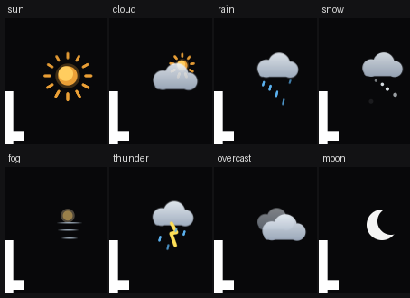
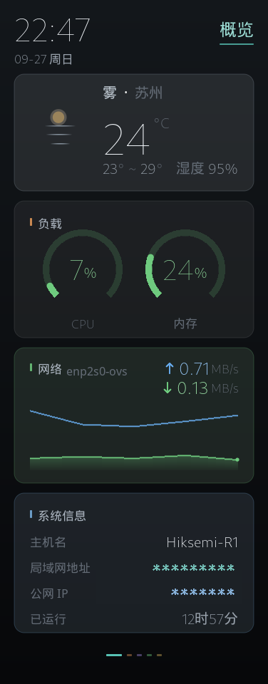
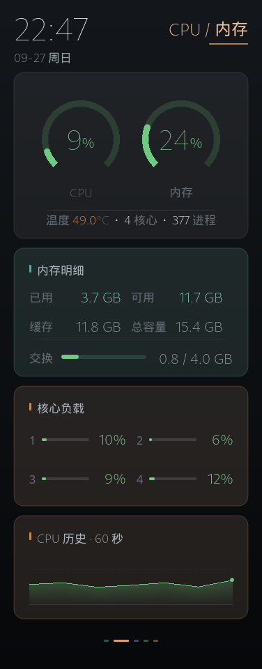
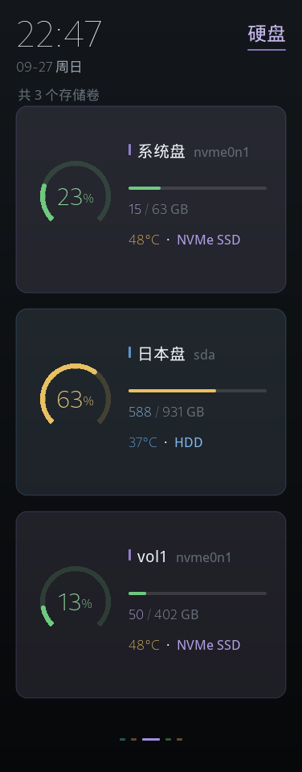
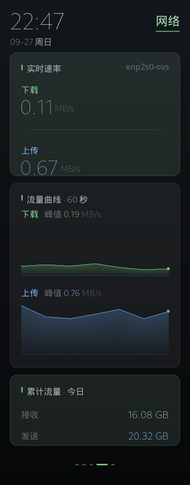
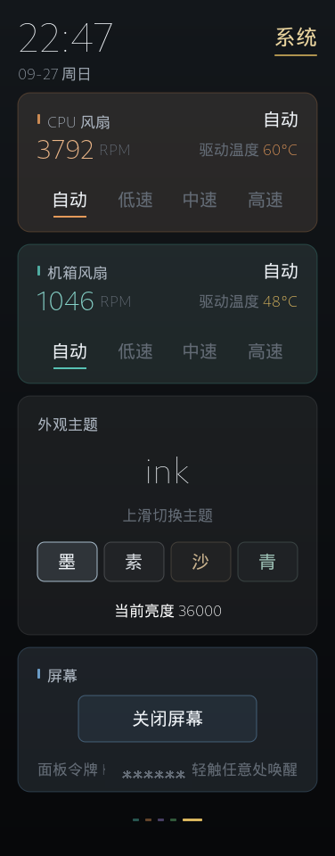

# R1 FrontScreen

海康威视 R1 / R1X NAS 前置触摸屏的硬件管理工具：Material You 三页信息面板（环境/详情/系统）、Web 控制面板、智能风扇调速、天气展示。

> **能装的机器只有一个系列**：海康威视 **R1 / R1X**（Intel N100）。它内置一块 376×960 的触摸屏，
> 程序用 KMS/DRM（`/dev/dri/card*`）直接画在屏上，再读背光 sysfs 与风扇 hwmon 做控制。
> 普通 PC、群晖、威联通装了也点不亮 —— 它们没有这块屏，也没有对应的背光与风扇节点。
> 还需要能 SSH 进 fnOS（或 Debian 系）并拿到 `sudo`。
>
> 满足这三条就往下看 [部署方式](#部署方式)：一条命令装完，不用装 Go，也不用编译。

> 本项目基于 [lemon6515/r1-toolbox-go](https://github.com/lemon6515/r1-toolbox-go) 增强 fork 而来，遵循上游 **GPL-3.0 + Commons Clause** 许可证，感谢上游作者的开源工作。

## 界面预览

### v0.9.6 · 三页信息屏 + 异常横幅 + 管理面板（当前）

| 环境（主屏） | 详情 | 系统 |
|:---:|:---:|:---:|
|  |  |  |

*三页触摸翻页 · 88px 大时钟+天气融合 · 首屏放趋势（CPU 60 秒曲线、面积填充）、每核明细在详情页 · 每卡一色的低饱和 tonal 配色 · 读数与进度条共用一套阈值色（<50 绿 / ≥50 沙金 / ≥80 珊瑚）· 三张图由 `cmd/preview -all` 在真机上直接采样渲染（不是截屏，也不修图），局域网与公网地址由该工具当场换成 RFC 5737 文档保留地址（`192.168.1.10` / `203.0.113.42`）*

管理面板（`http://<设备IP>:8080`，浅色 / 深色两套）：

| 浅色 | 深色 |
|:---:|:---:|
|  |  |

*面板只围着这块屏转：实时预览（与屏幕同一份采样离屏重绘）、页面显隐与顺序、亮度与开关屏、风扇曲线与 PWM 映射（改完立即生效）、灯效、显示设置（主题 / 12–24 小时制 / 天气 / 刷新节奏）、异常告警（阈值 / Bark 推送 / 触发与恢复记录）、24 小时历史曲线、容器列表与日志（只读）、磁盘占用分析（目录 Top N + 大文件）、硬件扫描。不做容器编排，也不复刻 fnOS 自带的系统管理。屏幕顶部有异常时会出现一条通栏横幅（常态不显示——无横幅本身就是「一切正常」的信号）。面板为两列布局：左列内容型、右列控件型，窄屏自动单列。图中「存储」卡的大文件列表含私人文件名，公开图里换成了说明文字，其余都是真机实况。*


<details>
<summary><b>天气图标全集（8 种，放大重配色后）</b></summary>

| 晴 | 多云 | 雨 | 雪 | 雾 | 雷雨 | 阴 | 夜 |
|:---:|:---:|:---:|:---:|:---:|:---:|:---:|:---:|
|  |

上图为 8 种图标合成验收图（`preview -wx <类型>` 逐个渲染）。图标是全屏唯一允许多色的区域：太阳金 / 雨蓝 / 雪白 / 雾灰蓝 / 霾土黄 / 闪电金，夜间的月与星保持中性银白。

</details>

**对比旧版五页（v0.3.0 及以前）的变化**：

| | 旧版五页 | 新版三页 |
|---|---|---|
| 页面结构 | 概览/性能/硬盘/网络/系统 | 环境/详情/系统 |
| 首屏主角 | 46px 顶栏小时钟 + 指标卡 | 100px 大时钟 + 天气融合（环境屏风格） |
| 负载表达 | 双环仪表 + 每核百分比 | 大数字 + 细进度条 + 每核条 |
| 配色 | 单强调色 + 语义色描边 | 每卡一个低饱和色相（tonal 卡面） |
| 上下行速率 | 数字行 | 独立大卡（大数字 + 双曲线 + 今日累计） |
| 公网 IP | 完整明文 | 完整明文（屏上不遮蔽，排障要读全；仅外发截图时替换为文档保留地址） |

<details>
<summary><b>旧版五页界面截图（点击展开）</b></summary>

| 概览 | CPU / 内存 | 硬盘 | 网络 | 系统 |
|:---:|:---:|:---:|:---:|:---:|
|  |  |  |  |  |

</details>

## 本 fork 的主要改进

| 方向 | 内容 |
|---|---|
| **性能** | CPU 占用从约 89% 优化到 **单核约 2%**（60 秒窗口实测在 1.6%~2.3% 之间波动，长期基线 2.1%；跳帧渲染 + 局部重绘 + 圆角遮罩缓存 + 亚像素插值 + 采样减频） |
| **安全** | Web 面板令牌鉴权（首次启动自动生成）；令牌明文只在**点按系统页控制卡里的「面板令牌」行**时显示 10 秒（物理接触即授权，路过的人看不到）、亮度/风扇曲线等接口输入校验、修复磁盘监控数据竞争（`-race` 验证）。**注意面板是明文 HTTP，仅限内网使用**，详见 [安全说明](#安全说明) |
| **体验** | 负载阈值色（读数与进度条同一套：**<50% 常态 · ≥50% 沙金 · ≥80% 珊瑚**；进度条常态为薄荷绿，不再有「黄字配绿条」）、天气图标静态化（相位冻结）、屏幕夜间自动调暗（18:00–06:00 背光降至 `night_brightness`）、配置文件保存保留注释、崩溃自愈（systemd 加固） |
| **可读性** | 指标数字常态色降到 `#D4D4D4`（纯白在 376×960 小屏上会「发光」，降一档后不再抢标题与点缀色的注意力）；时钟、卡片标题、主机名仍为纯白，保留信息层次顶端 |
| **可靠性** | systemd 看门狗（`Type=notify` + `WatchdogSec=30`，主循环卡死 30 秒内自动重启，不再「进程活着但画面定格」）、smartctl/lsblk 硬超时（D 状态进程不会卡住渲染）、采样移到后台协程 + 不可变快照（`-race` 实测归零）、GitHub Actions 五道门（fmt/vet/test/test -race/build） |
| **代码** | 渲染器模块化拆分（canvas / design / textrender / theme / widgets；设计常量与阈值取色集中在 `design.go`，改配色只动一处）、删除无人消费的死代码 |

## 硬件与系统要求

- 海康威视 **R1** 或 **R1X** NAS（程序经 SDL2 输出到前置屏幕，走 KMS/DRM 的 `/dev/dri/card*`；另需背光 sysfs 与风扇 hwmon。**无法在普通电脑上运行**）
- 飞牛 fnOS 或 Debian/Ubuntu 系发行版
- 编译需要 Go 1.19+；Docker 构建方式无需在本机装 Go

### 字体

两族分开渲染、各自探测，互不影响：

| 用途 | 字体 | 来源 |
|---|---|---|
| 数字 / 拉丁 | **IBM Plex Sans**（Thin / Light / Bold） | **嵌在二进制里**，首次启动解到 `/tmp/r1-toolbox-fonts/`，用户不用装 |
| 中文 | Noto Sans CJK → 文泉驿微米黑 → 文泉驿正黑 → Droid | 探测系统字体，从前到后取第一个能打开的 |

- **为什么拉丁要嵌字体**：数字必须等宽。Cantarell 的数字是比例宽度（100px 下 `1`=42px、`8`=58px），时钟从 `15:31` 换成 `08:05` 会宽出 41px；试过 Inter 更糟（44px）。IBM Plex Sans 十个数码完全等宽，且本就是给仪器面板设计的。字体按 OFL 1.1 分发（见 `internal/ui/assets/fonts/OFL.txt`）。
- **为什么中文不嵌**：思源黑体单个字重就 10MB，塞进二进制不划算。想用思源的话执行 `sudo apt install fonts-noto-cjk`（约 100MB）即可自动生效，没装则退回 wqy —— 两种都不影响功能。

## 设计规范（改界面时照这个来）

界面的一致性靠规则约束，不靠手感。八张卡片共用一套规格：

| 项 | 规则 | 代码位置 |
|---|---|---|
| **卡片标题** | **18px、卡色实色、距卡顶 +13、左内边距 22、字距 0** | `DCardTitle` |
| **卡名** | 2–4 字对象名，不带修饰词（「CPU」「内存」「磁盘」「温度」「设备」「网络 IP」「Docker」「控制」） | — |
| **右上角信息** | 16px、右对齐、与标题**同墨迹中心**、用语义色（结论用 mint/coral/sand） | `DMetaR` |
| **文字色阶** | 主值 `colWhite` / 次值 `colSub` / 标签 `colDim` / 分隔符 `colTab`，四级不混用 | — |
| **间距（TPart.Gap）** | **3** = 标签或单位紧跟值 · **7** = 并列项之间 · **8** = 「·」两侧 · **10** = 斜杠两侧留白 | — |
| **卡片配色** | 同页四张卡色相不重复；环境页 slate/rose/sand → sage/mint，详情 slate/rose/mint/sand，系统 slate/mint/rose/sage | — |

> 间距只有四个档位。2026-11-01 之前这里散落着 2/3/4/5/6/7/8/9/10 九个值，
> 同样的「数字 + 单位」在不同卡片里疏密不一 —— 看起来没毛病，但整屏就是不齐。

## 部署方式

> **三条硬前提**：海康 R1 / R1X · fnOS 或 Debian 系 · 能 SSH 进系统并拿到 `sudo`。
> 不满足的话，装完只会得到一个跑起来但点不亮屏幕的进程 —— 它要的是这台机器内置的那块屏，
> 不是任何显示器。

### 方式 A：一条命令（推荐）

```bash
git clone https://github.com/mingyangbest/r1-frontscreen.git
cd r1-frontscreen
sudo ./install.sh
```

不想 clone 整个仓库的话，只取脚本也一样（默认路线不需要仓库里其它文件）：

```bash
curl -fsSL https://raw.githubusercontent.com/mingyangbest/r1-frontscreen/master/install.sh -o install.sh
sudo bash install.sh
```

脚本取 **Release 里的预编译包**，不装 Go、不编译，全程不提问：

1. 先检查机型、`/dev/fb0`、`/dev/dri/card*`，不对就停下来说清楚原因
2. 只装运行时依赖（`libsdl2-2.0-0`、`libsdl2-ttf-2.0-0`、中文字体、`smartmontools`、`lm-sensors`、`i2c-tools`）
3. 下载 `r1-toolbox-linux-amd64` 并校验架构（Release 带 `.sha256` 时一并核对），旧二进制自动备份
4. 已有配置 `/etc/r1-toolbox/config.yaml` **先备份、不覆盖**（备份在 `/var/backups/r1-toolbox/`），只补缺失的

装完会直接告诉你三件事：屏幕是否点亮、面板地址 `http://<设备IP>:8080`、令牌在屏幕哪一页看。

常用参数：

| 参数 | 用途 |
|---|---|
| `--port 9000` | 面板端口（仅首次生成配置时生效） |
| `--version v0.9.6` | 装指定版本，默认最新 |
| `--binary ./r1-toolbox-linux-amd64` | 离线安装：用本地包，不联网 |
| `--from-source` | 从源码编译（改代码 / ARM 主板） |
| `--fix-grub` | 移除 GRUB 里的关屏参数（会改引导配置） |
| `--force` | 跳过硬件检查（无屏环境） |

> **下载卡住**：GitHub 在国内时通时不通。在能上网的机器上取
> `https://github.com/mingyangbest/r1-frontscreen/releases/latest/download/r1-toolbox-linux-amd64`，
> `scp` 到 NAS，然后 `sudo ./install.sh --binary ./r1-toolbox-linux-amd64`。

<details>
<summary>从旧版升级 / 手动管理服务</summary>

- 升级直接重跑 `sudo ./install.sh`：二进制换新、配置不动、服务自动重启。
- 旧版 `install.sh` 把配置写在 `/etc/r1-control/config.yaml`，和程序读的路径不是一个地方；
  新脚本会把它迁移到 `/etc/r1-toolbox/config.yaml`，你设过的端口与风扇曲线不会丢。
- 旧单元是 `Type=simple` 的话，新单元会覆盖它；如果另外加过 drop-in，记得删掉重复的
  `Type=` / `WatchdogSec=`：

```bash
sudo mkdir -p /etc/systemd/system/r1-toolbox.service.d
printf '[Service]\nType=notify\nWatchdogSec=30\n' | \
  sudo tee /etc/systemd/system/r1-toolbox.service.d/override.conf
sudo systemctl daemon-reload && sudo systemctl restart r1-toolbox
```

- 服务名、二进制名、配置路径沿用上游的 `r1-toolbox`（`systemd` 单元 / `/usr/local/bin/r1-toolbox` / `/etc/r1-toolbox/`），从上游或旧版升级无需迁移。

```bash
sudo systemctl status r1-toolbox   # 查看状态
sudo journalctl -u r1-toolbox -f   # 看日志
/usr/local/bin/r1-toolbox --version  # 查当前版本（v0.9.7+；更早的版本会启动第二个实例）
```

</details>

### 方式 B：从源码编译（改代码 / ARM 主板）

```bash
sudo ./install.sh --from-source
```

会装 Go 与 SDL2 开发库再 `make build`。R1 上首次编译约 1–3 分钟；ARM 主板只能走这条。
没有 Go 环境也可以用仓库里的 Docker 编译：

```bash
docker compose run --rm build      # 产物落在 ./build/r1-toolbox
```

### 方式 C：Docker 容器运行（⚠️ 实验性）

屏幕渲染需要特权设备访问，容器方式仅作尝试，**不保证在所有固件上可用**：

```bash
docker compose up -d screen   # privileged + /dev/fb0 + host 网络
```

遇到问题请回退方式 A。日常使用**推荐方式 A**。

### 方式 D：fpk 应用包（飞牛应用中心形态）

那才是完全不懂命令行的人能「点一下装好」的形态，但要走飞牛官方 `fnpack` 打包并逐固件实测。
**本仓库暂未附带打包配置**，现在请走方式 A。

## Web 控制面板

启动后浏览器访问 `http://<设备IP>:8080`。面板用 `X-Token` 头鉴权（首次访问会提示输入一次，之后存在浏览器本地）：

- **怎么拿令牌**：在设备屏幕上滑到「系统」页，**点一下「控制」卡里的「面板令牌」一行**，屏上显示明文 10 秒（原底部的令牌/数据药丸已删除，令牌并入控制卡）
- 也可以直接读文件：`sudo grep token /etc/r1-toolbox/config.yaml`
- 令牌只接受 `X-Token` 头，不走 URL 参数（避免被访问日志抄走）；连续 8 次错误锁定该 IP 5 分钟

能做什么：

| 分组 | 内容 |
|---|---|
| 屏幕 | 亮度、自动关屏时长、开 / 关屏（关屏需点两次确认） |
| 显示 | 主题（墨 / 素 / 沙 / 青）、12–24 小时制、天气显示或隐藏、刷新节奏（2 / 3 / 5 秒）——**改完立刻生效** |
| 风扇 | CPU / 机箱风扇的模式与温控曲线、PWM 通道与温度源映射（映射需重启服务生效） |
| 灯效 | RGB 模式与颜色（R1 前屏未见系统级灯效通路，可能无可见效果） |
| 硬件 | hwmon 扫描，列出本机风扇与温度传感器，换机器时用它确定通道 |

## 安全说明

**面板是明文 HTTP，没有 TLS，请只在内网使用。** 令牌在网络上明文传输，同一局域网内的嗅探者可以截获；拿到令牌就能控制这块屏幕（改亮度、关屏、调风扇）。

- **不要直接做端口映射到公网。** 如果确实要外网访问，请在前面加一层带 HTTPS 的反向代理（Caddy / Nginx / Traefik 均可），由反代终结 TLS，并且至少再加一道认证：

  ```
  # Caddy 示例（自动申请证书）
  screen.example.com {
      reverse_proxy 192.168.1.10:8080
      basicauth { admin <bcrypt-hash> }
  }
  ```

- **令牌目前没有轮换接口。** 泄露后的处理办法是手改配置文件并重启服务：

  ```bash
  sudo sed -i 's/^\(\s*token:\).*/\1 换成新的8位令牌/' /etc/r1-toolbox/config.yaml
  sudo systemctl restart r1-toolbox
  ```

- 面板不提供「重启服务 / 执行命令 / 上传文件」这类入口，**不要**为了图方便给它加一个。

## 配置

配置文件：`/etc/r1-toolbox/config.yaml`（程序每 5 秒热重载，改完即生效）。字段说明见 [`config.example.yaml`](config.example.yaml)。

天气数据来自[心知天气](https://www.seniverse.com/)免费接口，API Key 继承自上游项目（已随上游公开）；如失效可自行注册并替换 `internal/netinfo/netinfo.go` 中的 `senKey`。

## 已知限制

- 侧边 RGB 灯条：上游代码保留了 RGB 模块，但在 R1 前屏硬件上**未发现系统级软件控制通路**（实测内核 LED / I2C / ACPI 均无接口），灯效可能由屏体 MCU 硬件自带
- **设备卡的盘位数来自机型映射表**（当前仅 `HS-AFS-R1` → 4 盘位），不是硬件读数——Linux 没有暴露「盘位数」的通用接口，DMI 的 chassis 只报机箱类型。未映射的机型不显示该项。其余字段（机型名、CPU、内存类型与容量、fnOS 版本）**全部为系统实读**，读不到就整项省略，不填占位符
- 本程序为非官方项目，与海康威视、飞牛官方均无关联；刷写/安装产生的风险自负

## 更新日志

完整版本历史见 [CHANGELOG.md](CHANGELOG.md)(每个版本打 git tag 并发布 [Release](https://github.com/mingyangbest/r1-frontscreen/releases))。最近更新:

- **v0.9.6 · 2026-11-02**:**磁盘占用分析 + 风扇映射热重载**——面板「存储」卡按卷列出**一级目录 Top 8**（占比条）与大文件 Top 10（`du`/`find`，`-x` 不跨文件系统，du 自动硬链接去重；832G 机械盘实测 0.9 秒）；PWM 映射改动**立即生效**，不再需要重启（旧通道停在最后占空比，切回 auto 会让 BIOS 曲线接管突然拉满）
- **v0.9.5 · 2026-11-02**:**Docker 只读列表与日志**——面板「容器」卡列出全部容器（状态点/名称/人话状态/端口），点击「日志」在卡内展开深色日志区（最近 200 行；demux 多路复用流 + strip ANSI）；只读，无启停写操作
- **v0.9.4 · 2026-11-02**:**24 小时历史曲线 + 面板两列布局**——SQLite 单文件（`/var/lib/r1-toolbox/history.db`，WAL）每分钟一行聚合均值+峰值（CPU/内存/温度/磁盘/网络收发），保留 24h 超期自动删；写入在独立协程、不在采样热路径写库；面板「历史」卡五 tab + 均值线 + 峰值带（SVG 手绘），数据不足 24h 时自适应时间窗。布局从单列 1180px 堆叠改为两列主网格（左内容型/右控件型），**整页高度 -41%**，窄屏自动单列；告警记录折叠为最近 5 条
- **v0.9.3 · 2026-11-02**:**应用自检**（面板「自检」卡 + `GET /api/selfmon`）——进程 CPU（对 2.1% 基线三级着色）/ RSS / goroutine、帧耗时（平均·最大·慢帧 >33ms）、采样活性与失败计数、systemd 看门狗状态；实测 CPU 1.92→2.11% 落在基线上，证明 P2+P3 加完程序没变重；同期修复雨夜图标（不再强制画月亮）与令牌行中文乱码
- **v0.9.2 · 2026-11-02**:**异常横幅 + 五条规则 + Bark**——屏幕顶部 36px 通栏横幅（故障珊瑚底白字 / 预警沙金底深字，常态不显示），五条可调规则：磁盘 SMART（`smartctl -H`，只认明确 FAILED）/ 温度 70·80°C / 容量 90%（TOSHIBA 实测 88%）/ 容器异常（复用 Docker 卡判据）/ 网络掉线（连续 3 次防抖）；风扇停转按 PWM 映射路判「从有转速掉到 0」；Bark 推送（只收 https、接口永不回显 key、面板「发送测试」实测通道）+ 触发/恢复 JSONL 记录；系统页底部令牌/数据药丸删除，令牌挪进控制卡（点按亮 10 秒）；`config.LoadFrom` 改为以默认值为底再 Unmarshal——根修「缺段时 bool 被零值解成 false」的老坑
- **v0.9.1 · 2026-11-01**:**实时预览 + 页面显隐与顺序**——面板新增 `GET /api/preview`（与屏幕同一份 monitor 快照离屏重绘，**同源**，只叫预览不叫截屏）；`config.display.page_order + pages` 控制三页的显隐与顺序，下一个渲染帧生效；启用页列表与页签色走 atomic 快照，页面重建只在渲染帧边界执行；`` 不走 fetch 拦截器导致 X-Token 上不去（401 表现为纯黑破图），预览改 fetch blob
- **v0.9.0 · 2026-11-01**:**管理面板重做**（浅色 / 深色两套，卡片式布局，KPI + 分段控件 + 轻提示，关屏需二次确认）；面板首次能**读到设备的真实配置**（新增 `GET /api/config`，此前 PWM 3、35/75°C 是写死在前端的，打开面板就在说谎）；新增**显示设置**（主题 / 12–24 小时制 / 天气显隐 / 刷新节奏 2·3·5 秒，`POST /api/display`，改完立刻生效）；令牌改为**点一下药丸在屏上显示 10 秒**（此后 v0.9.2 药丸删除、令牌挪进控制卡）；CPU 曲线改为**面积填充**（曲线到图表底边线性淡出）并按实测把网格线定为 20/255
- **v0.8.9 · 2026-11-01**:设计一致性收口——八张卡标题统一 18px + 卡色（原小卡 15px、环境页两张主卡白色）；卡名统一成 2–4 字对象名（「CPU 负载」→「CPU」、「温度与风扇」→「温度」）；TPart 间距从九个值收敛为 3/7/8/10 四档；README 新增「设计规范」一节，把标题/色阶/间距/配色规则写成表
- **v0.8.8 · 2026-11-01**:拉丁与数字换成 **IBM Plex Sans**（嵌入二进制、数字完全等宽，解决 Cantarell 比例数字导致的宽度跳动）；大时钟 100 → 88px 以匹配新字宽；中文仍走系统字体探测（本机实测未装 Noto CJK，落在文泉驿微米黑）
- **v0.8.7 · 2026-11-01**:Docker 卡状态改为**健康（绿）/ 异常（红）**——判据是「异常容器数」而不是「运行数」，停掉的项目不算异常（`Exited (0)`、SIGTERM 143 都算正常停止，只有非零退出码 / unhealthy / restarting 才报），与飞牛和 Docker Desktop 的口径一致；首页药丸改为文字居中、去掉左侧绿点；CPU 卡标题简化为「CPU」；内存卡去掉「物理 16 GB」标注（系统页设备卡已有）；系统页「网络」改为「网络 IP」
- **v0.8.6 · 2026-11-01**:首页底部药丸只留「已运行 N 天 N 时」——容器计数已由系统页 Docker 卡承担，同一件事不必说两遍；三张预览图重拍（IP 仍为 RFC 5737 示例地址）
- **v0.8.5 · 2026-11-01**:系统页容器卡改成 **Docker 健康卡**——一行结论（`健康` / `N 个已退出`）+ 三行计数：`项目 N 个 · 运行 N · 停止 N` / `镜像 N 个 · 用中 N · 闲置 N` / `容器 N 个 · 运行 N · 退出 N`，每个维度都按「总数 = 运行 + 停止」给全；数据来自 Docker API 的 containers + images 两个接口
- **v0.8.4 · 2026-11-01**:系统页「上传·下载」卡与首页网络卡重复，删除（今日收/发并入首页网络卡底部），换成**容器卡**（`29 运行 / 30 总计` + 容器名列表，名取自 Docker API）；天气图标再放大 r 32 → 46（直径 92，已接近时钟右侧的可用上限）；三页卡片配色重排，**相邻卡片不再同色**（详情 slate/rose/mint/sand，系统 slate/mint/rose/sage）
- **v0.8.3 · 2026-11-01**:设备卡重做——一行写清「型号 · CPU · 内存类型容量 · 盘位数」（`HIKSEMI R1 · N100 · DDR5 16 GB · 4 盘位`，全部读自 DMI/SMBIOS 真值），程序版本号缩小调暗降为角标、完整版本打进启动日志；删掉详情页顶栏的「滑左翻页」提示；CPU 负载卡右上角的 load average 换成**总占用率**（与四根条直接呼应）
- **v0.8.2 · 2026-10-31**:天气图标放大重配色——r 21 → 32（面积 2.3 倍），色板整体提饱和约 25%（太阳金更暖、雨更蓝、云更白，色相语义不变），太阳光芒 8 → 12 根、线宽随尺寸跟涨；预览工具加 `-wx` 参数可逐个验收 8 种图标
- **v0.8.1 · 2026-10-31**:删掉每页顶部居中的小页名（「环境/详情/系统」——位置指示与底部三点页签完全重复）；省出的高度给卡间隙（20 → 28），详情/系统页最后一张卡的起点分毫不动；环境页大时钟上移 108 → 80、三个卡间隙顺手改齐为等距 30
- **v0.8.0 · 2026-10-31**:进度条与读数统一着色——CPU 每核条、磁盘容量条都跟随读数跳色（`barColor` / `diskBarColor`，与 `valColor` 共用阈值），不再出现「86% 的黄字配一条绿条」；取消四核身份色（原 C0~C3 各一色），红色只表示 ≥80%，C1 的珊瑚不再与告警色撞车；网络卡改两端对齐（标签贴左、地址贴右，原先右侧空 150px 等于没对齐）；指标数字常态色 `#E6E6E6` → `#D4D4D4`
- **v0.7.0 · 2026-10-29**:首页删除「存储」卡（容量一年看两次，却占着 137px），腾出的高度给网络曲线（40→122px，微弱波动终于看得出形状）；系统页「设备」卡补 CPU 型号与内核串（读 `/proc`，读不到显示 `—`）；底部页签间距 7→14px、点宽 7→8px，三个点不再挤成一坨
- **v0.6.2 · 2026-10-29**:修复翻页重播入场编排导致的画面抖动——手指刚把页面推到位、内容又整体淡入一遍；入场编排收窄为仅冷启动播放一次
- **v0.6.1 · 2026-10-29**:动效与质感——卡面顶部提亮/底部压暗渐变烘焙（每帧只 blit）、内存/存储/CPU 数值滚动、点按卡片亮度脉冲；CPU 占用最重场景（连续翻页 20 次）整机 4.23%
- **v0.6.0 · 2026-10-29**:工程化专项——并发收口（`-race` 7 处 DATA RACE 归零）、systemd 看门狗、smartctl/lsblk 硬超时、采样后台协程、近 30 个单测、GitHub Actions CI
- **v0.5.0 · 2026-10-28**:配色降饱和（bg 16~23%/强调色 13~20%）+ 排版系统重写（统一基线锚、字距与定值间隙），内存改为「物理 16 GB / 内核可见 15.4 GB」双口径，公网 IP 恢复屏上明文（外发截图单独打码）
- **v0.4.0 · 2026-10-28**:界面重构为 Material You 三页版——环境(大时钟+天气+多彩 tonal 卡)/详情/系统,新增容器监控与上传下载速度大卡,公网 IP 自动打码
- **v0.3.0 · 2026-10-28**:屏幕夜间自动调暗——18:00~06:00 背光降至 `night_brightness`,启动/唤醒/跨界均按昼夜取值,不覆盖手动调节
- **v0.2.0 · 2026-10-28**:夜间天气图标——18:00~06:00 晴天画满月+星、多云画云后小月,卡面色相同步转冷
- **v0.1.1 · 2026-10-12**:项目改名 R1 FrontScreen;修复 go.sum 缺失导致的编译失败
- **v0.1.0 · 2026-09-27**:首发——CPU 占用 89% → 2.1%、负载三态色、Web 令牌鉴权、Docker 部署

## 项目结构

```
cmd/main.go            程序入口
cmd/preview/           设计稿离屏渲染工具（把候选版面画成 PNG，不参与运行、不占屏幕）
internal/ui/           屏幕渲染：canvas / design（设计常量与阈值取色）/ textrender / theme / widgets / pages
internal/monitor/      CPU / 内存 / 网络 2 秒采样，磁盘 SMART / Docker 60 秒采样（后台协程 + 不可变快照）
internal/hardware/     背光、风扇曲线、触摸屏、hwmon 发现
internal/web/          Web 控制面板（gin + 内嵌前端，令牌鉴权）
internal/netinfo/      网络信息与天气（30 分钟刷新）
internal/config/       配置热重载（yaml.Node 键级合并，保留注释与键序）
web-ui/                Web 面板前端源码（Vue 3 + Vite）
```

## 开发

```bash
make build          # 或 docker compose run --rm build
go vet ./...
```

## 许可证

本项目继承上游的 **GPL-3.0 + Commons Clause** 许可证（见 [LICENSE](LICENSE)）：

- 任何分发/修改须同样以 GPL-3.0 开源，并保留原版权声明
- **Commons Clause**：不得将本软件及其衍生作品**用于销售或其他商业目的**

© 上游原作者 [lemon6515](https://github.com/lemon6515/r1-toolbox-go)；本 fork 的改动部分同样以上述许可证发布。
